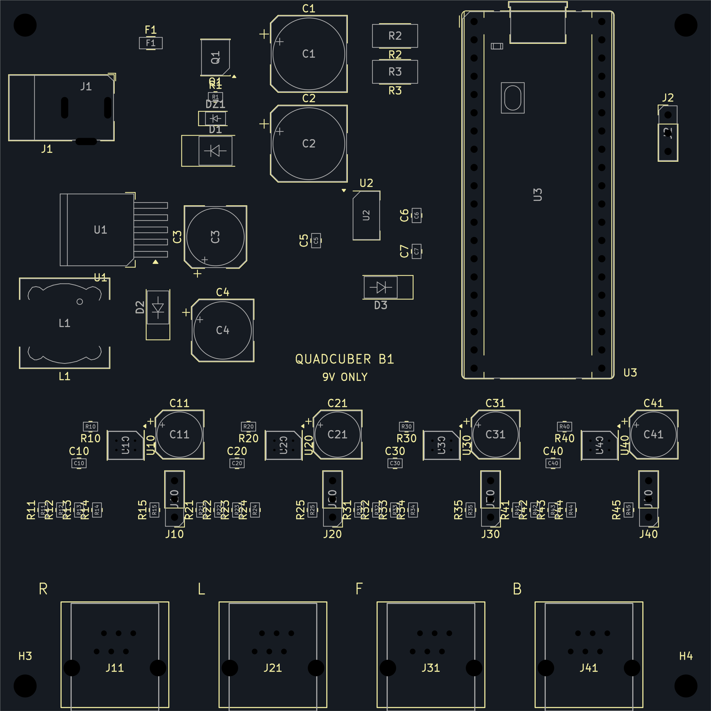

# B1 底板焊接与首次上电指南

适用于丝印 **QUADCUBER B1 / 9V ONLY**、99×99mm、插装 Pico H 的双层板。用户已于 2026-10-16 确认 PCB 和零件到手；本指南按仓库现有 B1 PCB、BOM 和采购记录编写，尚无本板焊接及通电实测记录。若实物布局与下图不同，先核对制板版本。

**本次采用：核料与试放 → 低矮贴片件分区点锡浆、热风焊接 → L1 热风焊接 → 烙铁焊电解和通孔件 → 断电检查 → 空板限流上电 → 编码器电平检查 → 插 Pico → 单臂测试。** 前几步均不插 Pico、不接 USB、电机、舵机或 Zero W；不要边焊边通电。

<a id="soldering-batches"></a>
## 操作总表：按批次焊完并勾选

**焊接时直接照这张表从上到下做，每批完成并检查后，在“完成”栏打勾。** 每个装配位号只出现一次；不要按 BOM 的旧“焊接顺序”列另排一次。第 1–7 批均为低矮贴片件，可连续使用热风，但逐区点浆、核料、回流、冷却检查，不在中途上电。

**读表方向：PCB 正面朝上、Pico USB 朝上、EV3 插口朝下。** 所有“左/右/上/下”都按这个视角；翻到背面焊通孔脚时左右镜像。IC 从有字顶面认 1 脚，先核本体标记，再对准 PCB pad1；标记不清时在 KiCad 查焊盘编号并确认实物资料，不带电猜方向。

“关键检查”中的小方框逐项勾选，全部完成后再勾本批“完成”。焊前确认方向和数值，焊后冷却再查焊点；通断/电阻测量均在断电且电容放电后进行。

| 完成 | 批次/位置 | 工具与耗材 | 位号（型号/规格） | 焊接位置数 | 本批关键检查（逐项勾选） |
| --- | --- | --- | --- | ---: | --- |
| □ | 1 输入保护区 | 热风枪＋LXZ920119 锡浆 | F1（1206 保险丝，8A/32V；慢断特性待确认）<br>Q1（AO4407A）<br>R1（10kΩ，0805）<br>DZ1（BZT52C12）<br>D1（SMBJ12A，单向）<br>R2（300Ω 1W，2512）<br>R3（300Ω 1W，2512） | 7 | □ 焊前：Q1 找本体角落的 1 脚标记，对照厂商顶视图确认，安装后 **1 脚在右下**；不靠字样朝向猜。<br>□ 焊前：DZ1、D1 找本体阴极横杠/色带，**两颗的标记端都朝左**，对应 PCB pad1；阴极不是“接地端”的同义词。<br>□ 焊前：R1/R2/R3、F1 不分正负；逐项核阻值、功率和规格，F1 的 M 标记不能证明慢断。<br>□ 上浆：Q1 只涂八个引脚焊盘，塑料底部下方不上浆。<br>□ 焊后：Q1 八脚无翘脚；1–3、5–8 各自同网但不留多余锡，尤其不能桥连到 4 脚；F1 两端无锡桥绕过本体。 |
| □ | 2 舵机降压区 | 热风枪＋LXZ920119 锡浆 | U1（LM2596S-5.0）<br>D2（SS34） | 2 | □ 焊前：U1 确认 **LM2596S-5.0**，不能用 ADJ；从有字顶面看，五个脚向右、大散热片在左，**最下面是 1 脚**。<br>□ 焊前：D2=SS34，找到阴极横杠/色带，**标记端朝下**，对应 PCB pad1。<br>□ 上浆：U1 五脚与大散热焊盘都要上浆；大散热片接 GND，不能只焊小脚。<br>□ 焊后：五脚无桥连、翘脚，大散热片实际润湿；暂不装 L1、C3/C4，也不通电。 |
| □ | 3 逻辑电源区 | 热风枪＋LXZ920119 锡浆 | U2（AMS1117-5.0）<br>C5（10µF/25V，0805 陶瓷）<br>C6（22µF/16V，0805 陶瓷）<br>C7（0.1µF，0805 陶瓷）<br>D3（SS14） | 5 | □ 焊前：U2 确认 **AMS1117-5.0**；三个小脚向左、大散热片在右，**左上为 1 脚**，不是 3.3V 型号。<br>□ 焊前：D3=SS14，阴极横杠/色带 **朝右**，对应 PCB pad1；不要与 D2 的 SS34 混料。<br>□ 焊前：C5/C6/C7 是无极性陶瓷电容，按包装核容量与耐压；C5=10µF、C6=22µF、C7=0.1µF，不凭外形判断。<br>□ 上浆/焊后：U2 小脚与大散热片均焊实；**大散热片接 5V_LOGIC，不是地**，检查是否误连相邻焊盘；小电容平贴、无立碑。 |
| □ | 4 R 臂低矮件 | 热风枪＋LXZ920119 锡浆 | U10（DRV8871DDAR）<br>C10（0.1µF，0805 陶瓷）<br>R10（43.2kΩ 1%，0805）<br>R11（10kΩ，0805）<br>R12（20kΩ，0805）<br>R13（10kΩ，0805）<br>R14（20kΩ，0805）<br>R15（220Ω，0805） | 8 | □ 焊前：U10=DRV8871DDAR，找到本体角落 1 脚标记并对照顶视图；安装后 **1 脚在右上角**，对应 PCB pad1，不以大圆注塑痕判断。<br>□ 焊前：R10=43.2kΩ；R11/R13=10kΩ；R12/R14=20kΩ；R15=220Ω，10kΩ/20kΩ 位置不能互换。<br>□ 焊前：C10=0.1µF 陶瓷；本批电阻和陶瓷电容 **均不分正负**，按数值与封装取料。<br>□ 上浆：U10 外围八脚＋**底部中心散热焊盘 pad9**均需少量上浆；中心接 GND，不堆浆或灌满过孔。<br>□ 焊后：IC 平贴、八脚润湿无桥连；小件无立碑/偏位/锡珠。外围焊好或地脚导通不能单独证明中心焊好，回流不明确时先排查。 |
| □ | 5 L 臂低矮件 | 热风枪＋LXZ920119 锡浆 | U20（DRV8871DDAR）<br>C20（0.1µF，0805 陶瓷）<br>R20（43.2kΩ 1%，0805）<br>R21（10kΩ，0805）<br>R22（20kΩ，0805）<br>R23（10kΩ，0805）<br>R24（20kΩ，0805）<br>R25（220Ω，0805） | 8 | □ 焊前：U20=DRV8871DDAR，找到本体角落 1 脚标记并对照顶视图；安装后 **1 脚在右上角**，对应 PCB pad1，不以大圆注塑痕判断。<br>□ 焊前：R20=43.2kΩ；R21/R23=10kΩ；R22/R24=20kΩ；R25=220Ω，10kΩ/20kΩ 位置不能互换。<br>□ 焊前：C20=0.1µF 陶瓷；本批电阻和陶瓷电容 **均不分正负**，按数值与封装取料。<br>□ 上浆：U20 外围八脚＋**底部中心散热焊盘 pad9**均需少量上浆；中心接 GND，不堆浆或灌满过孔。<br>□ 焊后：IC 平贴、八脚润湿无桥连；小件无立碑/偏位/锡珠。外围焊好或地脚导通不能单独证明中心焊好，回流不明确时先排查。 |
| □ | 6 F 臂低矮件 | 热风枪＋LXZ920119 锡浆 | U30（DRV8871DDAR）<br>C30（0.1µF，0805 陶瓷）<br>R30（43.2kΩ 1%，0805）<br>R31（10kΩ，0805）<br>R32（20kΩ，0805）<br>R33（10kΩ，0805）<br>R34（20kΩ，0805）<br>R35（220Ω，0805） | 8 | □ 焊前：U30=DRV8871DDAR，找到本体角落 1 脚标记并对照顶视图；安装后 **1 脚在右上角**，对应 PCB pad1，不以大圆注塑痕判断。<br>□ 焊前：R30=43.2kΩ；R31/R33=10kΩ；R32/R34=20kΩ；R35=220Ω，10kΩ/20kΩ 位置不能互换。<br>□ 焊前：C30=0.1µF 陶瓷；本批电阻和陶瓷电容 **均不分正负**，按数值与封装取料。<br>□ 上浆：U30 外围八脚＋**底部中心散热焊盘 pad9**均需少量上浆；中心接 GND，不堆浆或灌满过孔。<br>□ 焊后：IC 平贴、八脚润湿无桥连；小件无立碑/偏位/锡珠。外围焊好或地脚导通不能单独证明中心焊好，回流不明确时先排查。 |
| □ | 7 B 臂低矮件 | 热风枪＋LXZ920119 锡浆 | U40（DRV8871DDAR）<br>C40（0.1µF，0805 陶瓷）<br>R40（43.2kΩ 1%，0805）<br>R41（10kΩ，0805）<br>R42（20kΩ，0805）<br>R43（10kΩ，0805）<br>R44（20kΩ，0805）<br>R45（220Ω，0805） | 8 | □ 焊前：U40=DRV8871DDAR，找到本体角落 1 脚标记并对照顶视图；安装后 **1 脚在右上角**，对应 PCB pad1，不以大圆注塑痕判断。<br>□ 焊前：R40=43.2kΩ；R41/R43=10kΩ；R42/R44=20kΩ；R45=220Ω，10kΩ/20kΩ 位置不能互换。<br>□ 焊前：C40=0.1µF 陶瓷；本批电阻和陶瓷电容 **均不分正负**，按数值与封装取料。<br>□ 上浆：U40 外围八脚＋**底部中心散热焊盘 pad9**均需少量上浆；中心接 GND，不堆浆或灌满过孔。<br>□ 焊后：IC 平贴、八脚润湿无桥连；小件无立碑/偏位/锡珠。外围焊好或地脚导通不能单独证明中心焊好，回流不明确时先排查。 |
| □ | 8 功率电感 | 热风枪＋LXZ920119 锡浆 | L1（SLF12575T-330M3R2-PF，33µH） | 1 | □ 焊前：核对到货型号和 33µH 规格，底部两个金属端子各自落在左右焊盘，端子面朝 PCB。<br>□ 方向：L1 **不分正负**，可转 180°；不要转 90°使端子落到上下。左焊盘为 SERVO_5V，右为 BUCK_SW。<br>□ 试放：两端同时搭接、器件平稳，不用大锡团跨过悬空处；通用外框不等于 TDK 实物轮廓。<br>□ 焊后：两端真实润湿、无翘起；外缘锡熔了不能单独证明底部焊好。<br>□ 断电：两端蜂鸣通常正常，电感本来是低电阻线圈；蜂鸣不是焊接质量证明。完成此批后再装电解。 |
| □ | 9 贴片铝电解 | 烙铁＋现有 63% 锡焊锡丝，侧面焊 | C1（470µF/25V，贴片电解）<br>C2（470µF/25V，贴片电解）<br>C3（220µF/25V，贴片电解）<br>C4（470µF/16V，贴片电解）<br>C11（100µF/25V，贴片电解）<br>C21（100µF/25V，贴片电解）<br>C31（100µF/25V，贴片电解）<br>C41（100µF/25V，贴片电解） | 8 | □ 焊前：从包装和外壳逐颗核容量、耐压；C4 的 16V 规格不能放到 C1/C2 的位置。<br>□ 认极性：贴片铝电解本体深色色带通常标 **负极**，以实物厂商标识为准；另一端为正极，对准板上“+”及 pad1，负极对准 pad2。<br>□ 方向：**C3 正极朝下、负极色带朝上**。<br>□ 方向：**C1/C2/C4/C11/C21/C31/C41 正极朝左、负极色带朝右**，逐颗检查，不整批凭印象摆放。<br>□ 焊后：两端润湿、底座平稳，无锡球、翘起或外壳/底座热损伤；不再整区热风重吹。 |
| □ | 10 排针与排母 | 烙铁＋现有 63% 锡焊锡丝，背面焊 | U3（Pico H 插座，两条 1×20 排母）<br>J2（1×3 排针，2.54mm）<br>J10（1×3 排针，2.54mm）<br>J20（1×3 排针，2.54mm）<br>J30（1×3 排针，2.54mm）<br>J40（1×3 排针，2.54mm） | 6 | □ 焊前：U3 用两条 1×20 排母，插孔朝上、焊脚穿板，两排平行贴板；**暂不插 Pico**。<br>□ 针序：U3 按正面 USB 朝上的布局，左列从上到下 1–20，右列从下到上 21–40；第 39 脚是 VSYS，第 38 脚是 GND。<br>□ 针序：J10/J20/J30/J40 **从下到上 G / + / S**，即 pad1=地、pad2=舵机 5V、pad3=信号；排针本体无正负，接外设时不能反插。<br>□ 针序：J2 **从上到下 GND / TX / RX**，对应 pad1/2/3；它没有电源输出，不能按舵机口接。<br>□ 焊后：排针/排母垂直，每个通孔脚焊实、无相邻锡桥。断电冷却后可试插 Pico 检查对位，随后取下。 |
| □ | 11 DC 与 EV3 插座 | 烙铁＋现有 63% 锡焊锡丝，背面焊 | J1（DC-005，5.5/2.1mm 插座）<br>J11（EV3 插座，同批实物）<br>J21（EV3 插座，同批实物）<br>J31（EV3 插座，同批实物）<br>J41（EV3 插座，同批实物） | 5 | □ 试放：J1 插口朝板左边；四个 EV3 插口朝板下边，正面从左到右是 J11(R)、J21(L)、J31(F)、J41(B)。<br>□ 焊前及焊后断电核对 J1：用匹配插头追踪，**中心触点→pad1 正极，外筒→GND**；pad2/pad3 在本板均接地。<br>□ J1 插入插头后再次测量，中心不能被开关脚短到地；不按脚长猜正负。<br>□ 逐个 EV3 断电追踪六路：**1=M1、2=M2、3=GND、4=编码器 5V、5=A、6=B**；这是项目焊盘编号，不能对着插口外观凭左右数。<br>□ 焊后：通孔脚润湿、无桥连，塑料无变形；按第 5 节核各触点实际去向及相邻脚短接情况，再进入上电流程。 |

括号内直接列出本位置对应的型号或规格，逐项取料即可；没有已确认原厂型号的电阻、电容和插座按已知规格标注，不虚构料号。L1 按采购记录中的 TDK 型号标注，仍需核对到货实物；U3 本批只焊排母。

**数量口径：**第 1–7 批共 46 个位号，加 L1 为 **47 个热风装配位号**；电解 8 个，排针/排母 6 个，插座 5 个，合计 **66 个装配位号**。U3 一个位置实际焊两条排母，因此不是“66 颗散件”；Pico 待第 6 节验收后插入。H1–H4 是安装孔，不是漏装零件。

**温度只看第 2 节统一设置：**现有锡浆的热风从 300°C、低风量试调；锡丝标签的 250–280°C 工作温度含义尚待确认，不把它直接套到热风。整块板始终保持断电、Pico 不插，所有批次完成后依次执行第 5 节断电检查、第 6 节分级上电。

## 1. 桌面上同时打开这些资料

- [元件位置图 PNG](../generated/electronics-b1/assembly.png) / [可放大 SVG](../generated/electronics-b1/assembly.svg)
- [手焊 BOM](../generated/electronics-b1/bom-hand-solder.csv)：按位号取料，不按采购包数判断装板数量。CSV 中原有“焊接顺序”列是旧的按类别排序，实际操作采用本指南第 4 节的分区流程，L1 在电解之前焊。
- [原理图 PDF](../generated/electronics-b1/schematic.pdf) / [PCB 源文件](../electronics-b1/quadcuber-b1.kicad_pcb)
- [最终采购记录](b1-taobao-final-recommendation.md)：用于核实收到的规格及已知限制。



全文的上、下、左、右均按此**正面视图**：Pico USB 朝上，四个 EV3 插座朝下，从左到右 R / L / F / B。翻到背面焊通孔脚时左右会镜像，不能沿用正面数脚方向。部分丝印拥挤，请放大 SVG 或在 KiCad 点选焊盘查看编号与网络；不要依据文字离哪颗近来猜位号。

## 2. 现有耗材、工具和焊法选择

本次以**锡浆＋热风枪批量装配贴片件**为主，烙铁用于电解侧面端子、通孔件和局部补焊。分区处理便于核料和观察，也能减少逐件切换工具；不是一次把整板吹热或追求最大风量。

### 已确认的耗材

| 耗材 | 用户提供的包装信息 | 本次用途 |
| --- | --- | --- |
| 锡浆 | **LXZ920119**；有铅、含银、中温；熔点 **183°C** | 贴片焊盘点涂，配合热风回流 |
| 焊锡丝 | **63% 锡**；熔点 **183–190°C**；工作温度 **250–280°C** | 烙铁焊通孔件、电解端子，以及补焊 |

以上按标签记录，尚无完整厂家规格。不能把锡浆的“含银”套到锡丝，也不能仅凭“63% 锡”补写其余合金比例。**锡浆含焊料，不是单纯助焊剂**；反复补浆会增加焊锡量，不能靠堆锡浆解决不润湿。

另备电子用助焊剂、镊子、吸锡带、放大镜或显微镜、万用表、耐热板架、适合助焊剂的清洗剂。首次上电需可显示电流的限流 9V 实验电源及中心正 DC 插头。在通风处固定 PCB，断开所有电源；焊后冷却再清洗，干燥后再测量和上电。有铅耗材操作后洗手，桌面不放食物。

### 温度和风量：标签值与设备设置分开看

| 工具/耗材 | 试调方式 | 何时调整 |
| --- | --- | --- |
| 热风枪＋LXZ920119 | **300°C、低风量起步**；300–330°C 可作试调范围 | 先检查风嘴、距离、热量是否到达焊盘及预热；不是锡未熔就不断加温 |
| 烙铁＋现有锡丝 | 标签工作温度为 **250–280°C**，但尚未确认其定义；若厂家明确指烙铁设置，先按此范围试焊 | 能及时润湿即可；焊不动先查烙铁头清洁、上锡、大小和接触，再按厂家要求调整 |

**183°C 是锡浆标签熔点，不是风枪应设的温度；250–280°C 也不能未经确认就当成所有设备的统一设定。** 热风显示、烙铁头实测、焊点温度及芯片本体温度是不同概念。上述热风范围是试调建议，尚未在本板和你的设备上验证，不能替代厂家焊接曲线或元件耐热条件。

先在废板试调，低风量以不吹动 0805 为准；没有通用的风量百分比、风嘴距离或吹焊秒数。均匀加热，观察焊料合并、润湿和元件落座；条件允许时用热电偶测实际温度。不要靠长时间猛吹补偿传热不良，不把“所有器件都必须 350°C”当规则。焊接温度原理可参考 [Kester 工艺资料](https://www.kester.com/knowledge-base/faq)及 [HAKKO 烙铁温度建议](https://www.hakko.co.uk/maintenance/dereks-tech-tips/issue11/)。

### 焊法分工以批次表为准

[页首操作总表](#soldering-batches)是唯一的装配批次清单：第 1–8 批用锡浆＋热风，第 9–11 批用锡丝＋烙铁。下文解释工艺和检查方法，不另排第二套顺序。局部漏焊、桥连或单颗更换时，可用烙铁和吸锡带返修能接触到的焊点，不必重新吹整片区域。

### Q1 与 U10 外形相似，底部有什么不同

| 比较项 | Q1：AO4407A，SOIC-8 | U10：DRV8871，带 PowerPAD 的八脚封装 |
| --- | --- | --- |
| 外围引脚 | 8 个 | 8 个 |
| 底部中心 | 本项目封装没有裸露散热焊盘 | **有必须焊接的散热焊盘**，PCB 编号为 pad9，接 GND |
| 点锡浆位置 | 仅八个引脚焊盘，不在塑料底部下面堆浆 | 八个引脚焊盘＋底部中心散热焊盘，薄量均匀 |
| 烙铁能否完成所有焊点 | 可以，八脚均可从侧面接触 | 不能只焊外围八脚，底部接合处无法从侧面直接焊到 |

**两者都可以用热风，本次都按热风流程做。** 区别在上浆位置和隐藏焊点检查，不在于 Q1 “只能用烙铁”。U20/U30/U40 与 U10 相同。封装依据见 [AO4407A 原厂图](https://www.aosmd.com/sites/default/files/res/datasheets/AO4407A.pdf)及 [DRV8871 原厂资料](https://www.ti.com/lit/gpn/DRV8871)。

### 焊前试放与核料

- [ ] J1、四个 EV3 插座和两条 1×20 排母自然入孔、主体贴合，不强压或硬掰引脚。
- [ ] L1 两端实际搭接可靠；TDK SLF12575T-330M3R2-PF 与现有通用焊盘的差异见第 4 节 B。
- [ ] U1 是 **LM2596S-5.0 固定 5V**，不是 ADJ；U2 是 **AMS1117-5.0**，不是 3.3V。
- [ ] D1 是 **SMBJ12A 单向**，不是 SMBJ12CA；全部 IC、二极管、电解按第 3 节认方向。
- [ ] F1 采购器件为 1206 / 8A / 32V / “M” 标记，慢断曲线仍未确认；不能把 M 当作慢断证明，首次上电仍用外部限流。

## 3. 先核对所有有方向的器件

以下方向已按仓库 PCB 焊盘位置核对。**器件自身的 1 脚/阴极标识必须结合该型号资料识别，不以字样朝向推断。** 大圆形注塑痕不一定是 1 脚标记。

### 怎样认出 IC 本体的 1 脚

**先认芯片本体的 1 脚，再把它对准 PCB 的 1 号焊盘。** 操作时看芯片有字的顶面；数据手册里的 `Top View` 是顶视图，`Bottom View` 是底视图，两者左右镜像，不能混用。

对于 DRV8871、AO4407A 这类两侧各四脚的芯片：

1. 用放大镜和侧向照明找靠近角落的小圆点、凹点或厂商规定的 1 脚标记，对照该厂商封装图确认。不是每颗芯片都有相同的圆点；大圆形注塑痕不能直接当作 1 脚标记。
2. 如果封装使用端部半圆缺口标记，将缺口朝上，从顶面看左上为 1 脚。不要把侧边倒角或破损误当成这个缺口。
3. 将已确认的 1 脚转到左上角后，脚号按下图逆时针排列。此图是认脚示意，**不是 B1 板上的安装朝向**。

```text
       芯片顶面
      ┌────────┐
  1 ──┤ ●      ├── 8
  2 ──┤        ├── 7
  3 ──┤        ├── 6
  4 ──┤        ├── 5
      └────────┘
```

对照原厂资料：[DRV8871 引脚图（Pin Configuration and Functions）](https://www.ti.com/lit/ds/symlink/drv8871.pdf)、[AO4407A 顶视/底视图](https://www.aosmd.com/sites/default/files/res/datasheets/AO4407A.pdf)。实物品牌或封装标记不同时，按实物厂商资料核对，不能只凭型号相似套用标记。

LM2596S-5.0、AMS1117-5.0 是单侧出脚的封装，应结合小引脚和大散热片的位置判断，**不套用上面的八脚编号图**。U1 的引脚图见 [LM2596 数据手册的 TO-263 Top View](https://www.ti.com/lit/ds/symlink/lm2596.pdf)。在本板规定的正面朝向下，U1 五个脚朝右，最下面为 1 脚；U2 三个小脚朝左，最上面为 1 脚。

PCB 上先找封装附近的 1 脚三角/圆点标记；丝印被遮挡或不清晰时，在 KiCad 中点选焊盘查看编号 `1`，再按下表核对位置。不要仅凭“某个焊盘是方的”判定所有贴片封装的 1 脚。**看不清实物标记时先不焊，拍清楚顶面字样、标记和两侧引脚后再确认。**

### B1 板上的安装方向

保持 PCB 正面朝上、Pico USB 朝上、EV3 插座朝下，再对照下表。先不涂锡试放，确认芯片 1 脚与对应焊盘重合后再焊接。

| 位号 | 正面图中的朝向 | 电气核对 |
| --- | --- | --- |
| Q1 AO4407A | 1 脚在右下角 | 1–3=VM，4=GATE，5–8=VIN_F |
| U10/U20/U30/U40 DRV8871 | 1 脚均在右上角 | 1、7 和底部散热焊盘=GND；5=VM |
| U1 LM2596S-5.0 | 五个引脚向右，1 脚在最下方，大散热片在左 | 1=VM，2=BUCK_SW，3及散热片=GND，4=SERVO_5V，5=GND |
| U2 AMS1117-5.0 | 三个小脚向左，1 脚在左上，大散热片在右 | 1=GND，2及散热片=5V_LOGIC，3=VM；**散热片不是地** |
| DZ1 BZT52C12 | 阴极标记端朝左 | pad1 阴极=VM，pad2=GATE |
| D1 SMBJ12A | 阴极标记端朝左 | pad1 阴极=VM，pad2=GND |
| D2 SS34 | 阴极标记端朝下 | pad1 阴极=BUCK_SW，pad2=GND |
| D3 SS14 | 阴极标记端朝右 | pad1 阴极=VSYS，pad2=5V_LOGIC |
| C1/C2、C4、C11/C21/C31/C41 | 正极朝左、负极朝右 | pad1=正极，pad2=GND |
| C3 | **正极朝下、负极朝上** | pad1=VM，pad2=GND |
| Pico H（U3） | USB 朝板上边 | 左列从上到下 1–20，右列从下到上 21–40 |

### 哪些元件分正负，实物上怎样判断

B1 上需要核对极性的两端元件是 **8 个贴片铝电解电容和 4 个二极管**；电源及外接接口也要核对针序。IC、Q1 和 Pico 按前面的引脚方向安装，不能简单分成正、负两端。

**贴片铝电解：负极色带与 PCB 的“+”在相反侧。** 本板的圆柱形贴片铝电解通常用黑色或深色色带标出负极，另一侧为正极；具体以实物厂商标识为准。PCB 上“+”对应正极，电解焊盘 pad1 为正、pad2 为负。这是铝电解的判断方式，不要套用到钽电容等其他类型。

**特别注意 C3 与其他电解方向不同。** 先核容量和耐压，再看色带，不凭外壳大小或文字朝向判断正负。

**二极管：横杠或色带通常标阴极 K，另一端为阳极 A。** 对照 PCB 上的二极管符号时，符号的阴极横杠一侧对应 K；不要把封装外框线误当阴极标记。二极管的阴极不等于电源负极，也不一定接地，本板四颗二极管的阴极分别接在不同节点。

具体朝向统一查上面的“B1 板上的安装方向”表：DZ1、D1 的阴极朝左，D2 朝下，D3 朝右。实物标记不清时先查厂商标记说明或拍清晰照片确认，不凭字样朝向猜，也不要带电试方向。

**电源和外接插头按针脚定义判断：**

- **J1 DC 电源：中心正、外筒负。** 断电用万用表通断档确认实际触点：中心到 pad1，外筒到 GND；pad2、pad3 在本板均接地。插入匹配插头后再复核，不能根据引脚长短判断，具体操作见第 4 节 D。
- **J10/J20/J30/J40 舵机排针：从下到上 G / + / S**，分别为地、5V、信号。线色只作辅助，按实际舵机针序接；不要把三针插头反插或错一格。
- **EV3 插座：核对全部六路针序。** 不能只认正负就接电机，断电映射检查见第 5 节。
- **J2 UART 没有电源输出脚**，从上到下为 GND / TX / RX，不能当作舵机的 G / + / S 接口。

**本板不分正负的元件：**

| 类别 | 位号 | 仍需核对 |
| --- | --- | --- |
| 普通电阻 | 全部 R 位号 | 阻值、功率、封装；尤其 10kΩ 与 20kΩ 不装反位置 |
| 陶瓷电容 | C5/C6/C7/C10/C20/C30/C40 | 容量、耐压、封装；不能与有极性的铝电解混淆 |
| 保险丝 | F1 | 额定规格、封装及特性，不以安装方向判断 |
| 两端电感 | L1 | 电感量、电流参数及端子与焊盘的实际搭接 |

“不分正负”只表示这类两端器件没有极性安装要求，不代表可以互换规格。U1 的大散热片接地，U2 的大散热片接 5V_LOGIC，不能把所有大金属片都当作负极。

## 4. 实际装配顺序：热风分区完成，再用烙铁收尾

**全程断电、Pico 不插。** 每阶段冷却后放大检查，确认没有桥连、锡珠、偏位、漏焊，再进入下一阶段。首次操作先在废板练习 0805 和八脚芯片，不用主板反复试温度。

### A. 低矮贴片件：按区域点浆、摆件和热风焊接

这一阶段包括 **Q1、U1/U2、U10/U20/U30/U40、全部电阻、陶瓷电容、D1/D2/D3/DZ1 和 F1**。L1、电解、排母及插座暂不装，为风嘴和观察留空间。

对应页首操作总表的 **第 1–7 批**：输入保护区、U1 降压区、U2 逻辑电源区，再从左到右处理 R/L/F/B 四路驱动区。区域以元件位置图为准，不是电气隔离区；**中途不要给未装完的电源电路上电**。

每区都按下面一轮操作，不必把 IC 和旁边的小件拆成两次回流：

1. **核料：**只取当前区域需要的器件，对照下面清单及 BOM。一次处理一种阻值/容量，避免混料。
2. **点浆：**清洁焊盘，少量点涂。两端小件的两侧用量尽量一致；IC 外围焊盘分别薄量上浆。DRV8871 中心散热焊盘也要上浆，不堆大团、不灌满过孔；Q1 底下没有中心焊盘，不要在那里点浆。U1/U2 大散热片焊盘同样需要上浆。
3. **摆件：**在锡浆可操作时间内摆放，对齐焊盘，按第 3 节复核 IC 1 脚和二极管阴极。不要为了让文字正着读而转动器件。
4. **热风：**按第 2 节从低风量试调，均匀预热当前区域，再使接合处回流。避免高速气流推走 0805，不只盯着芯片顶部吹。大铜焊盘升温比小焊盘慢，不能因为旁边小件已经熔了就认定 IC 底部也已完成。
5. **冷却：**观察焊料润湿和器件落座后撤热，待焊料凝固再移动 PCB。后续区域尽量减少对已完成区域的重复加热；已焊器件再次熔化时不要碰动。
6. **检查与补焊：**放大检查八脚桥连、单端翘起、立碑、锡珠和虚焊。可接触的局部漏焊用烙铁补，桥连加助焊剂并用吸锡带处理。不要撬未熔焊点。

#### 本阶段小件核料表

| 规格 | 位号 | 数量 |
| --- | --- | --- |
| 43.2kΩ 1% | R10/R20/R30/R40 | 4 |
| 10kΩ | R1；R11/R13/R21/R23/R31/R33/R41/R43 | 9 |
| 20kΩ | R12/R14/R22/R24/R32/R34/R42/R44 | 8 |
| 220Ω | R15/R25/R35/R45 | 4 |
| 300Ω 1W，2512 | R2/R3 | 2 |
| 0.1µF，0805 | C7/C10/C20/C30/C40 | 5 |
| 10µF/25V，0805 | C5 | 1 |
| 22µF/16V，0805 | C6 | 1 |

**10kΩ 与 20kΩ 不要装反，220Ω 不要误拿成 220kΩ。** 每拆一种料先核包装，必要时装前量电阻；陶瓷电容通常无数值印字。板上并联路径会影响在路电阻读数。

DZ1、D1、D2、D3 与 F1 按所在区域一起焊，不必留到全部电阻之后。Q1 的 1–3 脚和 5–8 脚各自同网属于设计连接，但仍应清除多余锡，尤其避免连到 4 脚。

#### IC 和散热焊点验收

U1、U2 的大散热片必须焊实，不能只固定小脚；U1 大片接地，U2 大片接 5V_LOGIC。四颗 DRV8871 应平贴、外围八脚润湿；**外观正常、地脚导通或过孔有锡，都不能单独证明底部散热焊盘已焊好**。回流过程不明确、器件浮高或后续异常发热时，先排查返修，不继续带载。底部 PowerPAD 必须接合到地铜以散热，见 [TI DRV8871 热设计说明](https://www.ti.com/lit/gpn/DRV8871)。

### B. 第 8 批：L1 功率电感

L1 是舵机降压电路的 **33µH 功率电感**，在板左侧、U1 下方、D2 左边。采购记录的型号是 **TDK SLF12575T-330M3R2-PF**，外形约 12.5×12.5×7.5mm；先核对收到的包装型号。TDK 列明此型号支持回流和烙铁焊接，尺寸及焊接方式见[原厂产品页](https://product.tdk.com/en/search/inductor/inductor/smd/info?part_no=SLF12575T-330M3R2-PF)。

**它不分正负，但两个金属端子必须分别落在左右两个焊盘上。** 保持 PCB 正面、USB 朝上时，L1 左焊盘为 SERVO_5V，右焊盘为 BUCK_SW；电感两端可以互换，水平旋转 180° 不影响此处的电气连接。不要转 90° 让端子跑到上下，也不要按顶面文字是否正着读来决定方向。有金属焊接端子的底面朝 PCB，磁芯顶面朝外。

**先确认端子搭接，再选择焊法。** B1 使用通用焊盘，不是该 TDK 型号的推荐焊盘；原装配图的外形和 3D 模型也不是这颗 TDK 实物的精确外形。两焊盘中心距为 9.9mm，每个为 2.9×5.4mm。采购时的标称尺寸核对显示端子能落在焊盘内，但收到后仍需干放：从侧面观察两个金属端子是否同时贴住焊盘、是否有可接触的焊接位置。不能只看外壳盖住了丝印框就算匹配，也不能用大锡团跨过悬空处凑连接。

本次默认 **LXZ920119＋热风**，设置统一见第 2 节：先从 **300°C、低风量**试调，必要时在 300–330°C 内调整；不另给 L1 规定一个固定高温或固定吹焊时间。

1. 两个焊盘少量、均匀点浆，电感平放，确认两个金属端子都对准焊盘。
2. 均匀加热接合区域，留意旁边已焊的小件，避免风嘴碰撞或吹移。外缘锡浆熔化不代表底部已充分润湿，不持续对磁芯顶面猛吹。
3. 受热不足时先撤热检查，改善风嘴覆盖、预热和热传递；不直接升到 400°C 长时间硬烫，不按压或撬磁芯。搭接不良则先处理适配问题，不能靠堆锡补偿。
4. 冷却后检查平稳、不翘起，两端实际润湿，无锡珠或相邻短接。底部接合过程无法确认时先排查，不以“看起来固定住了”作为完成依据。
5. 断电测两端，低电阻线圈在通断档通常会响，这不是焊桥证据，也不能证明焊点牢固。开路需查漏焊或器件断线；普通万用表电阻档不能确认 33µH，两端对地另按第 5 节检查。

**烙铁备选：**如果两端接合处都能从侧面可靠接触，可用现有锡丝和烙铁。先少量预上锡定位一端，再焊另一端，最后复查第一端，避免锡团顶起器件。烙铁头应同时接触金属端子与 PCB 焊盘，不能只把熔锡涂在外缘；温度按第 2 节的锡丝说明判断。

### C. 第 9 批：八个贴片铝电解，改用烙铁

| 规格 | 位号 | 数量 |
| --- | --- | --- |
| 470µF/25V，10×10.5mm | C1/C2 | 2 |
| 220µF/25V，8×10.5mm | C3 | 1 |
| 470µF/16V，8×10.5mm | C4 | 1 |
| 100µF/25V，6.3×7.7mm | C11/C21/C31/C41 | 4 |

先干放，按第 3 节复核容量、耐压和正负；**C3 正极朝下，其余七颗正极朝左**。C4 的 16V 规格不能误装到 C1/C2 的位置。

1. 两端加少量适用助焊剂，一个焊盘少量预上锡。
2. 摆正电容，从侧面同时加热端子和焊盘，重熔定位；不要把烙铁压在铝壳或塑料底座上。
3. 焊另一端，复查第一端。确认两侧端子真正润湿、底座贴稳，不只在边缘留下锡球。
4. 冷却后检查，不再对整区反复吹热风。若实物端子完全无法从侧面接触，先查该批电容允许的回流工艺，不直接照 IC 的方法长时间吹外壳。

### D. 第 10–11 批：排针、排母和插座

1. U3 安装两条 1×20 排母，不能把 Pico H 直接焊死。用夹具保持两排平行、贴板，先焊端部定位脚，检查垂直度后再焊剩余脚。断电且冷却后试插 Pico，确认没有错一排/错一格，**随后取下**再继续焊。
2. 焊 J2、J10/J20/J30/J40。舵机排针从下到上为 **G / + / S**；J2 从上到下为 **GND / TX(GP0) / RX(GP1)**。J2 没有电源输出脚。
3. 焊 J1 及 J11/J21/J31/J41。先焊一脚定位，检查主体贴板，再焊余脚。通孔焊接从背面同时加热引脚和焊盘，送锡至接合处；正面端子也应有润湿，不能只在背面堆锡球。
4. 断电用匹配 DC 插头核通断：**中心触点→J1 pad1，外筒→GND**；本板 pad2、pad3 均接 GND。不同 DC-005 实物开关结构可能不同，插入插头后再次检查，中心正极不能被开关脚短到地。
5. EV3 插座按下一节做六路实际触点映射。不要把普通 RJ12 或相反视角的脚序当作已有核对结果。

### E. 局部返修与装配完成检查

单颗两端小件用烙铁返修时，可先给一个焊盘少量上锡，镊子放件并重熔定位，再焊另一端、复查第一端。烙铁头应清洁且上锡，优先选适合焊盘的刀头/斜面头；焊不动先撤开检查接触，不硬压焊盘。

- [ ] 所有低矮贴片和 L1 已完成，才安装电解、排母与塑料插座。
- [ ] 对照 BOM 核对装配件，无漏件；U3 是两条排母加后续插装 Pico。
- [ ] 补焊后的方向、桥连和松动重新检查，不能只检查第一次焊接结果。
- [ ] 如需热风返修，先考虑附近电解和塑料件的耐热与遮挡，必要时先拆下受影响器件，不直接按初装方式整区重吹。
- [ ] 冷却后按耗材要求清洗并彻底干燥，然后执行第 5 节断电验收。

## 5. 断电验收：不通过就不通电

全程不接电源、USB、Pico、电机、舵机。万用表约定：**二极管档红表笔为正**；凡写“两向”都要交换表笔各测一次。表中数值是空板静态读数，以 ±30% 为通过范围；“0.000”指两向都读 0 且不随时间变化。任何一行不通过，先按右列处理并复测，再往下做；全表通过才进入第 6 节。

**先放电**：DC 电压档测 C1 正极对 GND，低于 0.1V 再切换档位；不要用镊子短接电容放电。


### 5.1 方向核对

| 步骤 | 操作 | 通过 | 不通过 → 处理 |
| --- | --- | --- | --- |
| 1 | 对照 `assembly.png` 逐位号点数，BOM 共 66 个装配位号 | 无漏件、无错位 | 补装或更换 |
| 2 | 8 个电解看色带：C3 色带朝上，C1/C2/C4/C11/C21/C31/C41 色带朝右 | 全部符合 | 拆下重装；反装过且已通过电的电容报废 |
| 3 | 4 个二极管：D1、DZ1 标记端朝左；D2、D3 按第 3 节 | 全部符合 | 拆下重装 |
| 4 | Q1、U1、U2、U10–U40 的 1 脚位置按第 3 节表 | 全部符合 | 拆下重装 |

### 5.2 电源输入到 VM（不通过直接看 [VM 短路排查](b1-vm-short-debug.md)）

| 步骤 | 档位 | 红表笔 | 黑表笔 | 通过 | 不通过 → 处理 |
| --- | --- | --- | --- | --- | --- |
| 5 | Ω | J1 中心触点 | F1 左焊盘 | <1Ω | J1 虚焊；用实物插头插入后复测 |
| 6 | Ω | J1 中心触点 | J1 外筒 / pad3 | OL | 插座开关脚短到中心，换插座或剪开关脚 |
| 7 | Ω | F1 左焊盘 | F1 右焊盘 | <1Ω | 保险丝断或虚焊 |
| 8 | 二极管 | F1 右焊盘（VIN_F） | GND | 0.4–1.0V | 0.000：Q1 之前短路，查 J1、F1 焊盘与地铜 |
| 9 | 二极管 | GND | F1 右焊盘（VIN_F） | OL | <0.3V：Q1 漏源击穿或 Q1 焊反 |
| 10 | Ω | C1 正极焊盘（VM） | GND | 读数上升后稳定在 **120–200Ω** | <10Ω 不变：VM 短路；>300Ω：R2/R3 漏焊或 VM 主干断 |
| 11 | 二极管 | GND | C1 正极焊盘（VM） | **0.4–0.8V** | 0.000：D1 击穿或 VM 短路；OL：D1 漏焊或装反 |
| 12 | 二极管 | C1 正极焊盘（VM） | GND | OL 或缓慢上升 | 0.000：VM 短路 |
| 13 | Ω | Q1 4 脚（GATE） | GND | 10kΩ | OL：R1 漏焊；0Ω：R1 桥连 |
| 14 | 二极管 | Q1 4 脚（GATE） | C1 正极焊盘（VM） | 0.6–0.8V | OL：DZ1 漏焊或装反；0.000：DZ1 击穿 |

### 5.3 两路 5V 与 VSYS

| 步骤 | 档位 | 红表笔 | 黑表笔 | 通过 | 不通过 → 处理 |
| --- | --- | --- | --- | --- | --- |
| 15 | 二极管 | C4 正极焊盘（SERVO_5V） | GND | OL 或缓慢上升 | 0.000：SERVO_5V 短路，查 C4、U1 2/4 脚、J10–J40 中脚 |
| 16 | 二极管 | GND | C4 正极焊盘（SERVO_5V） | 0.2–0.5V（经 L1 到 D2） | OL：D2 或 L1 漏焊；0.000：D2 击穿 |
| 17 | 二极管 | C6 任一端非地侧（5V_LOGIC） | GND | OL 或缓慢上升 | 0.000：5V_LOGIC 短路，查 C6、C7、U2 散热片是否碰地 |
| 18 | 二极管 | GND | C6 非地侧（5V_LOGIC） | OL 或 >1V | 0.000：U2 损坏或桥连 |
| 19 | 二极管 | C6 非地侧（5V_LOGIC） | U3 排母第39脚 | 0.2–0.5V | OL：D3 漏焊或装反；0.000：D3 击穿 |
| 20 | 二极管 | U3 排母第39脚 | C6 非地侧（5V_LOGIC） | OL | <0.3V：D3 装反 |
| 21 | Ω | U3 排母第38脚 | GND | <1Ω | 第38脚不是地：排母焊错位，核对 38/39/40 |
| 22 | Ω | U3 排母第40脚 | 第39脚 | OL | 相邻脚桥连 |
| 23 | Ω | U2 散热片 | GND | 同第18步读数，不是 0Ω | 0Ω：散热片桥到地铜，重焊 U2 |

### 5.4 四路驱动（R/L/F/B 各做一遍）

| 步骤 | 档位 | 红表笔 | 黑表笔 | 通过 | 不通过 → 处理 |
| --- | --- | --- | --- | --- | --- |
| 24 | 二极管 | GND | EV3 插座 pad1（M1） | 0.4–0.8V | 0.000：该路 DRV8871 输出短路或下桥击穿 |
| 25 | 二极管 | GND | EV3 插座 pad2（M2） | 0.4–0.8V | 同上 |
| 26 | 二极管 | EV3 pad1（M1） | C1 正极焊盘（VM） | 0.4–0.8V | 0.000：上桥击穿或 5/6 脚桥连；OL：6 脚漏焊 |
| 27 | 二极管 | EV3 pad2（M2） | C1 正极焊盘（VM） | 0.4–0.8V | 0.000：上桥击穿或桥连；OL：8 脚漏焊 |
| 28 | Ω | EV3 pad1（M1） | EV3 pad2（M2） | OL | 两输出桥连 |
| 29 | Ω | 该路 ILIM 电阻（R10/R20/R30/R40）非地端 | GND | 43kΩ | 0Ω：桥连；OL：漏焊 |

### 5.5 EV3 插座六路追踪

用 EV3 线缆插入插座，另一端通断档逐路追踪并填下表；相邻两路之间必须 OL。不要向未知触点带电试探。

| 项目焊盘编号（不是凭插口外观数的脚序） | R/L/F/B 四路分别应到达 | 不通过 → 处理 |
| --- | --- | --- |
| 1，M1 | U10/U20/U30/U40 的第6脚 | 针序与实物不符：记录实际映射，接电机前改 `firmware/pico/config.py` 或换线 |
| 2，M2 | 对应 DRV8871 第8脚 | 同上 |
| 3，GND | 地 | 同上 |
| 4，编码器 5V | 5V_LOGIC（U2 输出） | 同上；若到了 VM，禁止接电机 |
| 5，编码器 A 原始信号 | R11/R21/R31/R41 的 pad1 | 同上 |
| 6，编码器 B 原始信号 | R13/R23/R33/R43 的 pad1 | 同上 |

### 5.6 结果

- 第 1–29 步全部通过，六路映射记录完毕 → 进入第 6 节，用 9V/0.3A 限流电源或第 [VM 短路排查](b1-vm-short-debug.md) 第 4 步的串电阻法上电。
- 任一步不通过 → 处理后从该步起复测；涉及 VM 的（第 10–12 步）按 [VM 短路排查](b1-vm-short-debug.md) 对分隔离，不要逐件拆。
- 把第 10、11、15、17 步的读数填入第 8 节记录表，上电出问题时这是判断“装配故障还是上电损坏”的唯一依据。

## 6. 第一次上电：只测板，不带负载

1. 板放在绝缘支架上，**Pico、USB、EV3 线、舵机、UART 全部断开**。电源关闭输出，设为稳压 9V、限流 0.3A，核对插头中心正，再接 J1。
2. 黑表笔在断电时固定到 GND（例如 U3 第38脚），红表笔套绝缘，只露探针尖。不要在密集 IC 引脚间滑动，优先量电容或连接器焊盘。
3. 开启输出，观察电源读数并依次测下表。若电压起不来、持续限流、异味或器件快速升温，立即关断，回到断电检查；不能直接调高限流“顶过去”。

| 测点 | 表笔落点 | 预期/检查动作 |
| --- | --- | --- |
| VIN | J1 pad1 / F1 输入侧 | 约 9V |
| VM | C1 或 C2 正极 | 接近输入 9V；明显偏低先查 F1、Q1 及焊接 |
| SERVO_5V | C4 正极 / 任一舵机排针中间脚 | 约 5.0V，首次静态筛查取 4.75–5.25V |
| 5V_LOGIC | C6/C7 的 pad1 / D3 阳极 | 约 5.0V，首次静态筛查取 4.75–5.25V |
| VSYS | U3 第39脚（右列从上数第二孔） | 接近 5V_LOGIC、略低于它；约 4.6V 只是估算，不是固定压降 |

空载二极管压降会较小，不能因 VSYS 接近 5V 就认定 D3 短路。若 VSYS 接近 9V 或超出预期 5V 电源范围，禁止插 Pico。Pico 的供电连接请参见 [官方 Pico 数据手册 §4.5](https://datasheets.raspberrypi.com/pico/pico-datasheet.pdf)。本表是首板静态筛查，不代表纹波、瞬态或负载能力已经通过；有示波器时应进一步检查两路 5V 的启动和纹波。

### 插 Pico 前，单独检查编码器分压

**先确认电平，再插 Pico。** 10kΩ 串联、20kΩ 下拉的理想比例为 2/3；若输入高电平是 5.0V，输出计算值为 3.33V，并不保证低于 3.3V，电阻和电源容差还会改变它。面包板曾工作也不等于这块 PCB 已通过。

1. 保持 Pico 和舵机不接。在 EV3 六路映射确认后，断电接入一个电机的编码器线，确保轴和机构可自由运动；上电不发送驱动命令，手动缓慢转轴。
2. 测下表 A/B 分压节点的低、高电平。万用表只能在轴停在稳定状态时读高低电平，转动中的平均值不能作为峰值证明；优先用示波器检查。无稳定高电平/无法确认时，不视为通过。
3. 本指南采用保守筛查：高电平超过 3.3V 或存在不明尖峰，暂不连接 Pico，先复核/调整分压或电平转换，并确认逻辑高、边沿与最大转速下计数仍满足要求。**不要依靠 Pico 输入保护把过压钳住。** 当前 PCB/BOM 仍为 10kΩ/20kΩ，实测前不把它记为已通过。

| 臂 | 分压节点（下拉电阻 pad1） | 对应 Pico 物理脚 |
| --- | --- | --- |
| R | A=R12，B=R14 | 6(GP4)，7(GP5) |
| L | A=R22，B=R24 | 16(GP12)，17(GP13) |
| F | A=R32，B=R34 | 21(GP16)，22(GP17) |
| B | A=R42，B=R44 | 24(GP18)，25(GP19) |

### 再接主控和单臂

1. 检查通过后，断电、等待放电，拔下 EV3 线，插入 Pico H，USB 朝上；重新核对无错位。先只给 9V，确认 Pico 正常启动且电源无异常。
2. 需要烧录时使用适合手中 **Pico H/RP2040** 的固件；`electronics/firmware/QUADCUBER_A1` 是裸芯片 A1 板的专用配置，不要照搬。B1 本身不需要 A1 那套专用 Flash 初始化。
3. 之后每次断电接入一臂，先无机械负载、低速短时检查电机与编码器，再进行舵机独立标定。可参考[单臂操作与标定](single_arm.md)，但其中 DRV8833 模块接线不能照搬到 B1 的 DRV8871。
4. 不直接运行四臂满载、长时堵转或快速反转；焊接完成不等于供电、散热、回生及固件四臂控制已验收。限流值只在已有测量依据后逐步调整，不能因为保险丝为 8A 就设为 8A。

## 7. 常见现象与排查入口

| 现象 | 先断电，再检查 |
| --- | --- |
| 上电立即持续限流 / 电源自动关闭 | 电源正负、二极管/电解方向、IC 桥连、VM 对地、DC 插座开关脚；VM 对地短路的分步隔离见 [VM 短路排查](b1-vm-short-debug.md) |
| VIN 有 9V、VM 没有 | F1、Q1 型号与 1 脚、R1/DZ1 和漏焊 |
| VM 正常、舵机 5V 异常 | U1 是否固定 5V、D2 方向、L1 两端、C3/C4、U1 反馈脚焊接 |
| VM 正常、逻辑 5V 异常 | U2 是否 5.0V、方向、散热片是否误短到地、C5/C6/C7 |
| 两路 5V 正常、VSYS 异常 | D3 方向、虚焊及 U3 第39脚路径 |
| 单个驱动异常发热 | 该路焊桥、DRV8871 方向与底部散热焊点、输出短路；不要继续带载 |
| 编码器读数异常 | 插座六路映射、10k/20k 是否装错、分压电平、信号地；不是先改固件补偿 |

## 8. 首板记录（每块板各填一份）

| 项目 | 实测/记录 |
| --- | --- |
| 日期、PCB 版本/板号 | |
| 风枪/烙铁型号、风嘴/烙铁头、实际设置 | |
| 锡浆/锡丝标签、分区焊接及 L1 回流情况 | |
| IC、二极管和电解方向复核 | |
| DC 插头插入后的通断 / EV3 六路映射 | |
| 断电验收第 10/11/15/17 步读数（VM Ω、VM 反向二极管、SERVO_5V、5V_LOGIC） | |
| 电源设定 / 无 Pico 空载输入电流 | 9V / 0.3A；实测： |
| VIN / VM | |
| SERVO_5V / 5V_LOGIC / VSYS | |
| R/L/F/B 编码器 A/B 高低电平及测量方式 | |
| 插 Pico 后输入电流 / 启动结果 | |
| 异常、返修位号与复测结果 | |

文档依据：[B1 电路定义](../electronics-b1/circuit.py)、[实际 PCB](../electronics-b1/quadcuber-b1.kicad_pcb)、[手焊 BOM](../generated/electronics-b1/bom-hand-solder.csv)及上述采购记录。方向表以正面焊盘坐标为准，实物照片和通电结果应在完成装配后补入记录。
