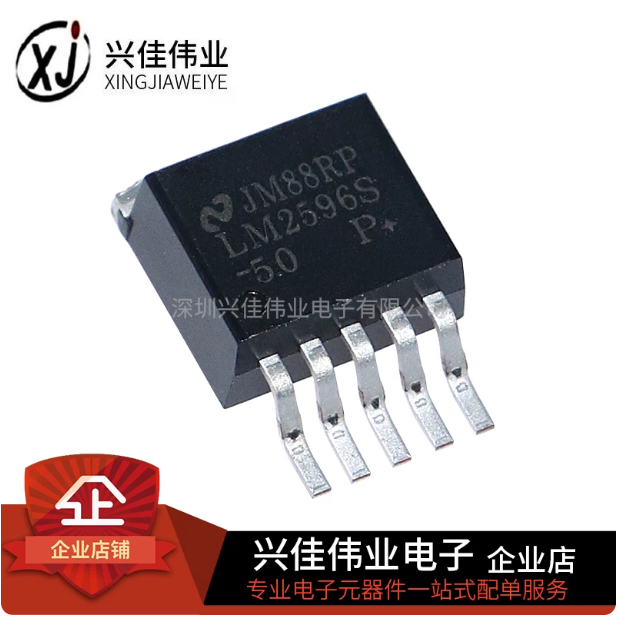
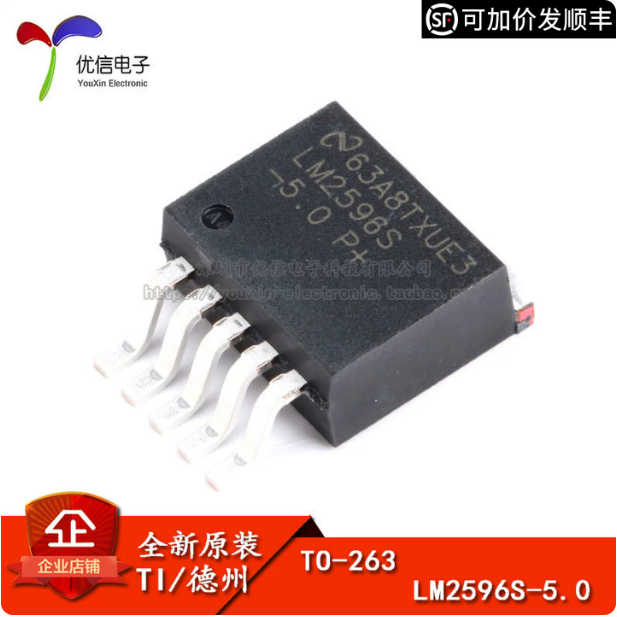
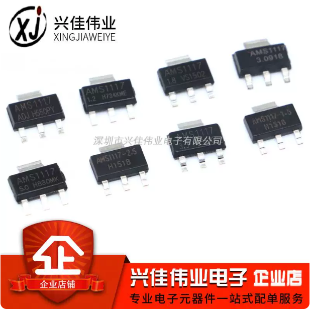
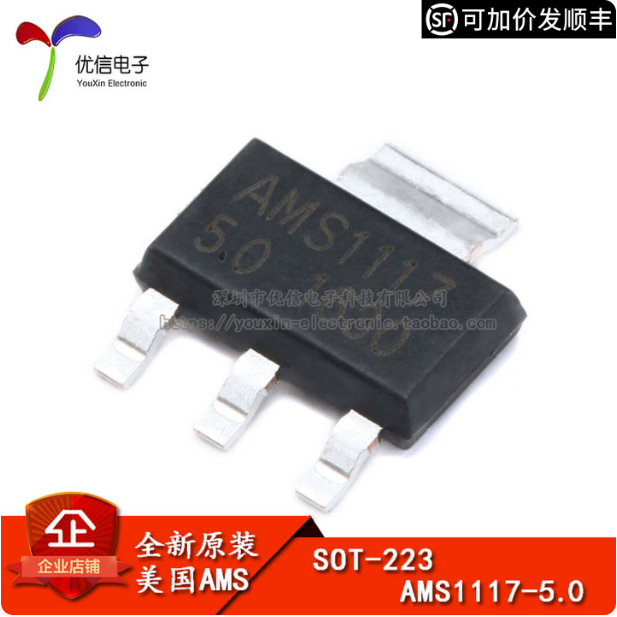
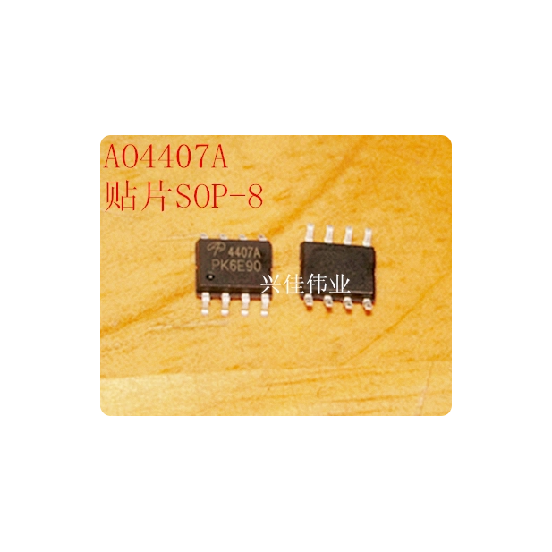
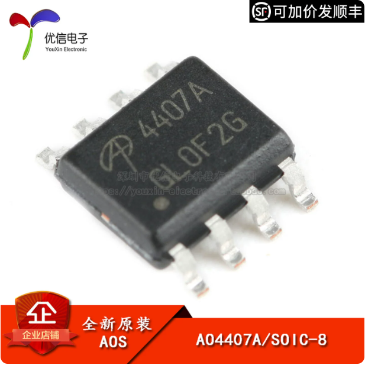

# B1芯片型号补查：淘宝照片与技术文档

核对日期：2026-10-14。分别在淘宝搜索 LM2596S-5.0、AMS1117-5.0、AO4407A，找到优信带“技术文档”的对应商品，并与兴佳商品主图对照。以下为用户接受的按照片判断同标称型号的方法；不把相同外观当作来源鉴定。

## LM2596S-5.0

- [兴佳商品](https://item.taobao.com/item.htm?id=16340580059)：管装，1只 ¥0.44。照片可读 NS 标识、LM2596S、-5.0，5脚 TO-263。
- [优信参考商品](https://item.taobao.com/item.htm?id=522577612783)：1只 ¥4.99。照片同样为 NS 标识、LM2596S、-5.0，5脚 TO-263；批次字符串不同。
- [商品附带资料](https://itemcdn.tmall.com/attachment/icoss10631293188eaeb28213fe4377)；参数以[TI现行数据手册](https://www.ti.com/lit/ds/symlink/lm2596.pdf)为准。固定5V，150kHz，3A降压系列；1 VIN、2开关输出、3 GND、4反馈、5 ON/OFF。
- 结论：选择兴佳固定5V款，不能改选 ADJ 或 LM2596HVS 选项。价格节省 ¥4.55。

|兴佳照片|优信参考照片|
|---|---|
|||

## AMS1117-5.0

- [兴佳商品](https://item.taobao.com/item.htm?id=582103232969)：选择“AMS1117-5.0 / SOT223”，1只 ¥0.05。系列合照左下芯片能读到 AMS1117、5.0，三脚和背面大焊片形状一致。
- [优信参考商品](https://item.taobao.com/item.htm?id=522575569083)：1只 ¥0.58，照片为 AMS1117、5.0、SOT-223。
- 已打开商品技术文档 `51244-2020-10-31.PDF`：[AMS数据手册附件](https://itemcdn.tmall.com/attachment/icoss3539451610151f97a51262063c)。包含固定5.0V的 SOT-223 订货型号；1 GND、2 VOUT、3 VIN，散热片接输出。
- 结论：保留兴佳 ¥0.05 款；SOT-89、TO-252及其他电压不替代。

|兴佳照片|优信参考照片|
|---|---|
|||

## AO4407A

- [兴佳商品](https://item.taobao.com/item.htm?id=18199180781)：1只 ¥0.10。照片能读到 4407A 和 AOS 图形标识，8脚外形。
- [优信参考商品](https://item.taobao.com/item.htm?id=619612296393)：1只 ¥1.12。照片同样是 4407A、AOS 标识、SOIC-8，批次字符串不同。
- 已打开技术文档 `68497-2020-11-02.PDF`：[商品附件](https://itemcdn.tmall.com/attachment/icoss256905231619a11f6a9c747f9)。该旧附件部分导通电阻行存在不一致，实际参数引用[AOS现行原厂数据手册](https://www.aosmd.com/sites/default/files/res/datasheets/AO4407A.pdf)：P沟道，VDS −30V、VGS ±25V，SOIC-8；1—3 S、4 G、5—8 D。
- 结论：选择兴佳4407A款替代易鑫天诚UMW款，省 ¥0.25。搜索结果里把它写成“N沟道”的商品不作为参考。

|兴佳照片|优信参考照片|
|---|---|
|||

以上图片为商品照片区域截图，已去除账户和收货信息。采购数量与总价见[最终采购清单](b1-taobao-final-recommendation.md)。
