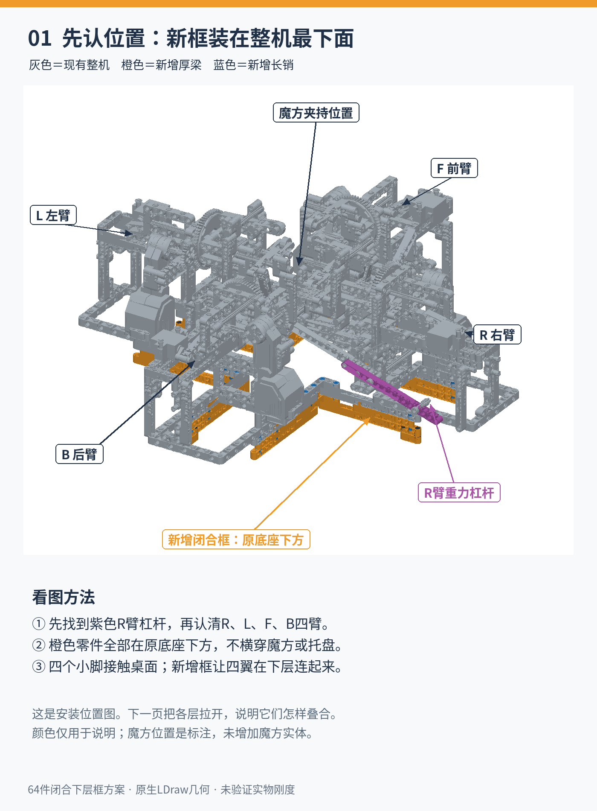
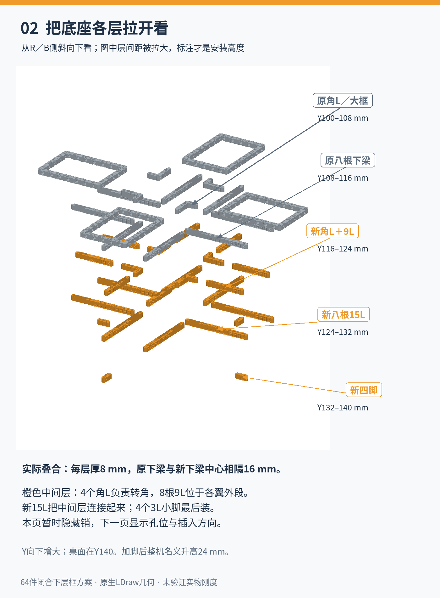
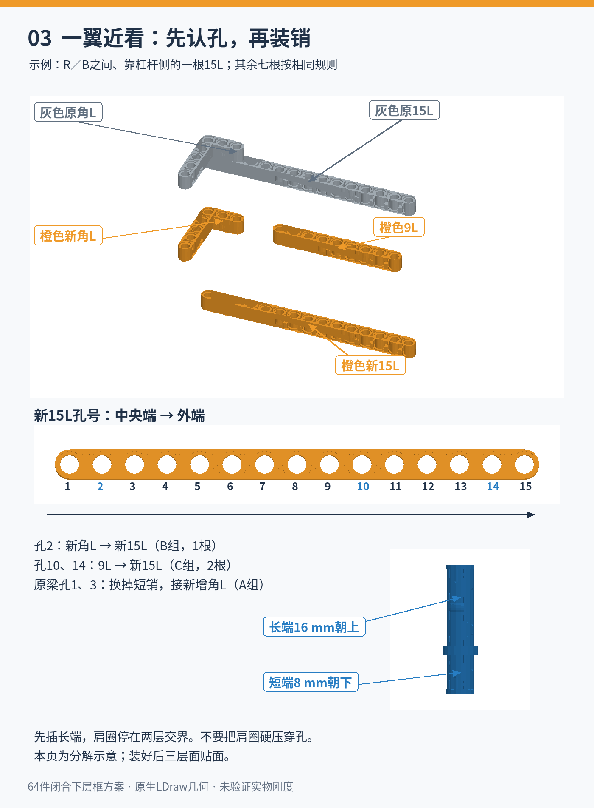
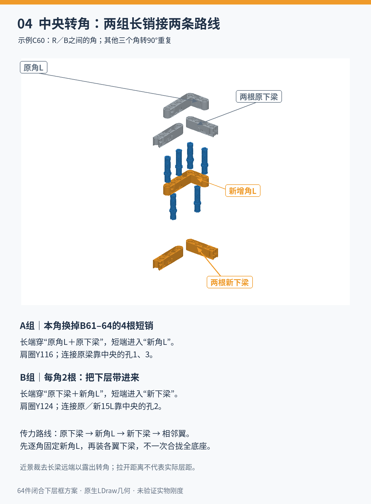
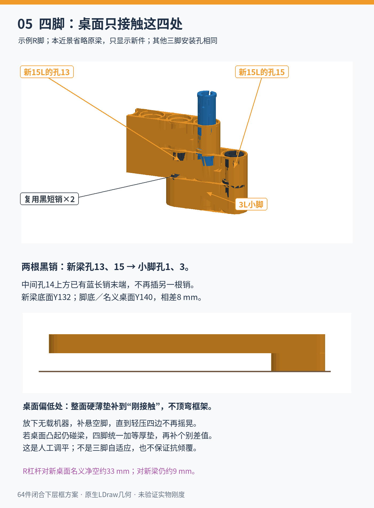
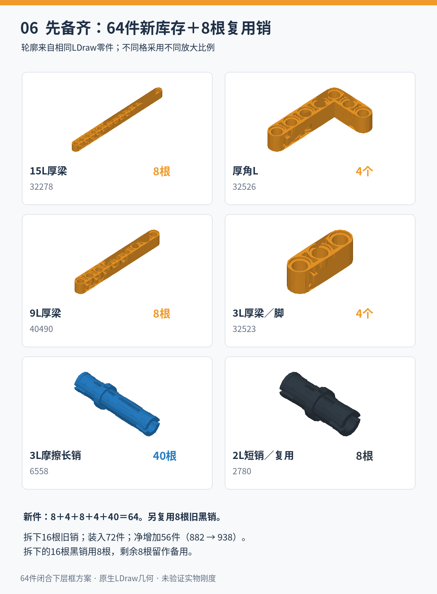
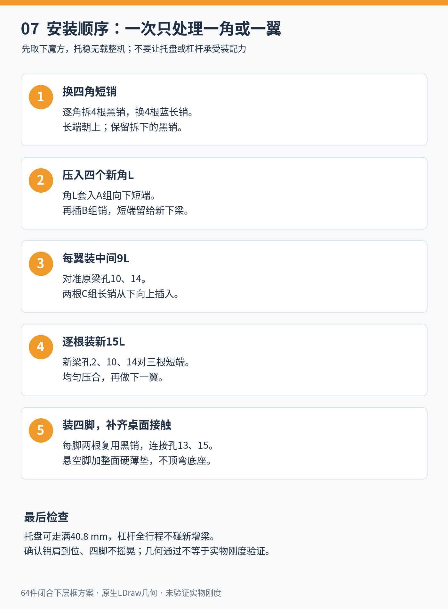

> **本分支已落实为938件全机结构。** [最终542步从零说明](../../../../generated/site/integrated-assembly.html)是主装配路径；下面七页保留为旧机加装图解及原提案记录。新增64件库存、复用8根短销，不是复用8个支脚。

# 64件闭合下层框：七页图解

**独立提案，不是当前标准装配手册，也不是44件省件版本。** 本说明以当前882件整机为基线，解释如何在原底座下加一组闭合框及四脚。标准模型、501步正式手册和电子工程保持不变。模型源提交为 `1205c918de4908b7a156859f565424dce133ba53`。

[七页PDF](base-stiffening-64-illustrated.pdf) · [几何验证范围](VALIDATION.md) · [文件大小与SHA-256](artifact-manifest.json) · [返回当前机械装配入口](../../README.md)

灰色是原件，橙色是新增厚梁，蓝色是新增6558长销，黑色是复用2780短销；紫色只标示原R臂杠杆。颜色用于说明，不代表采购颜色要求。所有零件形状由原生LDraw网格绘制。爆炸图有意拉大层间距，实际尺寸以标注为准；近景裁去远端以露出连接，不表示需要切割实物。

## 1. 先认整机位置

先找到紫色R臂杠杆，再识别L、R、F、B四臂。橙色框全部在原底座下方，不横穿魔方夹持区或移动托盘。四个小脚负责接触桌面。图中魔方位置是指向夹持区的标注，没有增加魔方实体。

## 2. 从上到下怎样叠

坐标Y向下增大，孔距8 mm。下表为实际安装高度，图中为方便阅读已把各层拉开。

| 层 | 实际Y范围 |
|---|---|
| 原角L及大框架 | 100–108 mm |
| 原八根下梁 | 108–116 mm |
| 新四个角L及八根9L | 116–124 mm |
| 新八根15L | 124–132 mm |
| 四个3L小脚 | 132–140 mm |

原下梁与新下梁中心相隔16 mm；新脚底为Y140，较原名义桌面Y116抬高整机24 mm。新角L连接相邻翼，中间9L把各翼原下梁和新下梁在外段连起来；它们不是全长连续腹板，不能当作粘合实心梁或箱梁计算刚度。

## 3. 一翼孔号与销方向

15L从靠中央端向外编号1–15。图示为R／B之间靠杠杆侧的一翼，其余七根采用相同孔位规则。

- 原梁孔1、3：替换原短销，连接新增角L，属于A组。
- 原／新15L孔2：经新增角L连接，属于B组。
- 原／新15L孔10、14：经中间9L孔5、9连接，属于C组。

6558的16 mm长端朝上（−Y），8 mm短端朝下（＋Y）。长端先进入宿主孔，肩圈停在层间接缝；不要把肩圈硬压穿孔。新下梁最后套在B／C组三个向下短端上。

## 4. 中央转角：两组连接不能混淆

每角A组4根、B组2根，共四角。

| 组 | 上方16 mm长端穿过 | 下方8 mm短端进入 | 肩圈Y |
|---|---|---|---|
| A | 原角L＋原下梁 | 新角L | 116 mm |
| B | 原下梁＋新角L | 新下梁 | 124 mm |

图示C60转角替换原B61–64四根短销；另外三角分别替换B24–27、B40–43、B56–59。B编号沿用原底座零件序号。A组对应原梁孔1、3，B组对应原／新梁孔2。

连接路线是“原下梁→新角L→新下梁→相邻翼”。跨L、R的约束经相邻翼和中央角连接实现，没有新加一根横穿托盘的横梁。四臂和托盘固定支架仍先把载荷传到原底座，再进入这组下层连接；移动托盘不是底座拉杆。

## 5. 四脚、孔13／15与桌面

**本64件版的脚固定在新15L孔13、15，连接脚的孔1、3。不能混用44件版的孔13、14。** 每脚两根复用2780，肩圈Y132。梁孔14上方已有C组蓝销末端，不再向该孔段插另一根销。

| 脚 | 所在新下梁对应原件 | 脚中心XYZ（mm） |
|---|---|---|
| R | B02 | (152,136,−32) |
| F | B29 | (32,136,152) |
| L | B13 | (−152,136,32) |
| B | B45 | (−32,136,−152) |

新下梁底面Y132到脚底Y140相差8 mm。无载放下机器，用覆盖整个脚底的硬薄垫补齐悬空脚，直到轻压相邻边不再摇晃；不要继续塞到抬起另一边或顶弯底座。若桌面凸起仍碰梁，四脚先统一加同厚硬垫，再补个别高度差。桌面受按压继续变形时，固定垫片不能动态补偿。

四脚不是自动调平机构；实际重心及手部按压力未知，未认证抗倾覆。R外柄对新名义桌面的净空约33 mm，对新增梁仍约9 mm，不能据此宣称夹手间隙消失。

## 6. 零件与数量账目

全部新增梁为厚梁，不使用任何长度的全圆孔薄梁。

| 零件 | 新库存 | 复用 |
|---|---:|---:|
| 15L厚梁32278 | 8 | 0 |
| 厚角L32526 | 4 | 0 |
| 9L厚梁40490 | 8 | 0 |
| 3L厚梁32523，作脚 | 4 | 0 |
| 3L摩擦长销6558 | 40 | 0 |
| 2L摩擦短销2780 | 0 | 8 |
| 合计 | **64** | **8** |

拆下16根旧2780，其中8根装脚、8根留余。装入64件新件＋8件复用件＝72件；净增72−16＝56件，整机882→938件。硬垫数量和厚度由桌面接触决定，不计入LEGO件数。

## 7. 分步安装

1. 取下魔方，独立托稳无载整机，留出底面操作空间。不要靠托盘或杠杆承担装配力。
2. 一次处理一个转角：换4根A组长销，再把新角L套入向下短端。
3. 从下方插入B组长销，长端穿新角L和原下梁，短端朝下。
4. 每翼把中间9L贴在原梁下面，孔5、9对准原梁孔10、14，插入两根C组长销。
5. 每次只装一根新15L，孔2、10、14对准B／C组三个短端，均匀压合。
6. 四个指定位置装脚，补齐桌面接触，再检查托盘完整40.8 mm及杠杆全行程。

此顺序依据孔轴和端部方向制定，未做手部可达性或插入力实物验证。不要整机几十根销一起压合，也不要强行矫正有载弯曲的原框架。

48处连接孔轴和名义运动包络已核查；这不能证明真实销连接摩擦、实物刚度、承载或抗倾覆。完整方法与边界见[验证说明](VALIDATION.md)。
