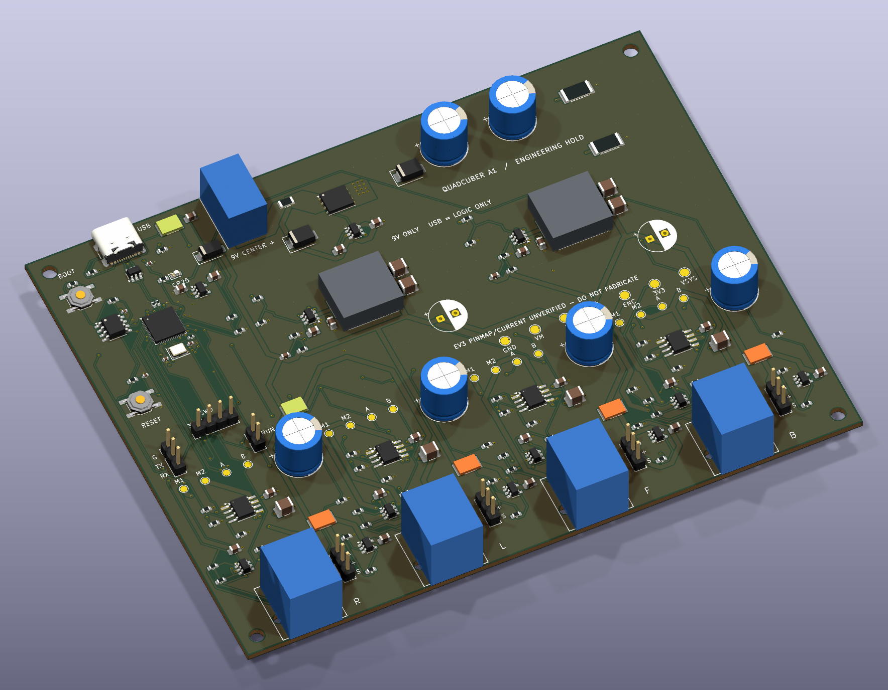

# PCB 3D 显示修复发布验证

基线`b0c1822d67cf4002c179fc86d4f697d17ba24381`，官方KiCad10.0.7。原问题包括下载后未关联模型以及Lite缺少系统3D库。本次把模型随工程分发，171个装配器件均能显示，C26/C36保持DNP并默认隐藏；27个测试焊盘和安装孔无需器件主体。

[顶视](board-top.png) · [底视](board-bottom.png) · [路径和几何不变核验](verification.json) · [STEP核查](geometry-validation.json) · [DRC](drc.rpt)

## 发布内容和许可取舍

25个KiCad模型使用其CC-BY-SA4.0许可及设计例外，作者和许可保留；5个项目自制STEP按CC0-1.0分发。Bourns原厂CAD再分发授权未能确认，条款页正常请求HTTP403；因此最终发布F2/F3和L1/L2的独立简化尺寸模型，**不是此前本地预览使用的对齐原厂实体**。两个原厂STEP从当前发布树移出，执行环境保留原件；历史Git提交未重写。来源哈希记录保留，不将许可未确认说成禁止使用，也不声称历史副本消失。

|器件|最终显示|限制|
|---|---|---|
|F2/F3|MF-MSMF050 Style1简化最大尺寸块4.73×3.41×0.85mm|无端子凹口和金属层，不是精确原厂CAD|
|L1/L2|SRP1245A Lead Frame简化最大尺寸块14.0×12.8×5.0mm|依据图纸公差上限；不猜内部线圈/端子结构|
|F10–13|MF-MSMF110/16X Style2简化最大尺寸块4.83×3.41×0.80mm|未采用误返回的050模型|
|J1|9×14.5×11mm名义主体|依据父线程原图视觉核验；本环境仍无原始PDF，不绘制未知内部/焊尾|
|J10–13|12.2×15×14.95mm名义主体|用户图未给完整固定耳、卡扣外廓；不是完整碰撞包络|
|F1及其他标准封装|已归档KiCad模型|通用外观，不逐一冒充BOM精确原厂CAD|
|C26/C36|DNP且显式隐藏模型|真实焊盘仍保留|

细节、可分发性和来源见[模型说明](../../../electronics/lib/3dmodels/README.md)、[简化模型清单](../../../electronics/lib/3dmodels/project-models.json)、[KiCad来源及哈希](../../../electronics/lib/3dmodels/kicad/sources.json)。原厂L模型的12.9mm总跨度低于13.0mm图纸下限，作为历史审查证据保留；当前简化块采用图纸上限，没有暗中缩放原厂CAD。

## 验证和使用

- 原生加载200个封装；171个装配器件的可见模型全部存在，路径均为`${KIPRJMOD}`，库与板内引用一致。无需系统模型库。
- 全部30个STEP经OpenCascade重新导入，均含有效实体；5个项目模型由生成脚本独立构造，不导入原厂CAD。
- PCB及所有使用的本地封装库，移除`model`节点后全部S-expression tokens与基线逐项一致：包括孔铜、走线/过孔、铜区及实填铜、网络、位置/旋转、UUID、文字、DNP属性。工程/规则文件字节不变。
- KiCad DRC：0违规、0未连接、0原理图一致性问题；顶/斜/底三视图均由原生KiCad重新渲染。没有改机械或固件，没有制造放行。
- 此处记录提交前验证；CI结论以该发布提交对应的GitHub Actions运行记录为准。旧`j1-raspc722x-revision/remaining-3d.json`是此前提交历史快照，不代表本次状态。

拉取`feat/onboard-rp2040-a1`后打开`electronics/quadcuber.kicad_pro`，从工程启动同目录PCB；也可直接打开`electronics/quadcuber.kicad_pcb`。使用KiCad10.0.7，按Alt+3打开3D查看器。保留完整`electronics/lib/3dmodels/`目录，无需逐个下载模型。若已有编辑器窗口，保存自己的修改后关闭并重新打开，避免继续显示内存中的旧板。
