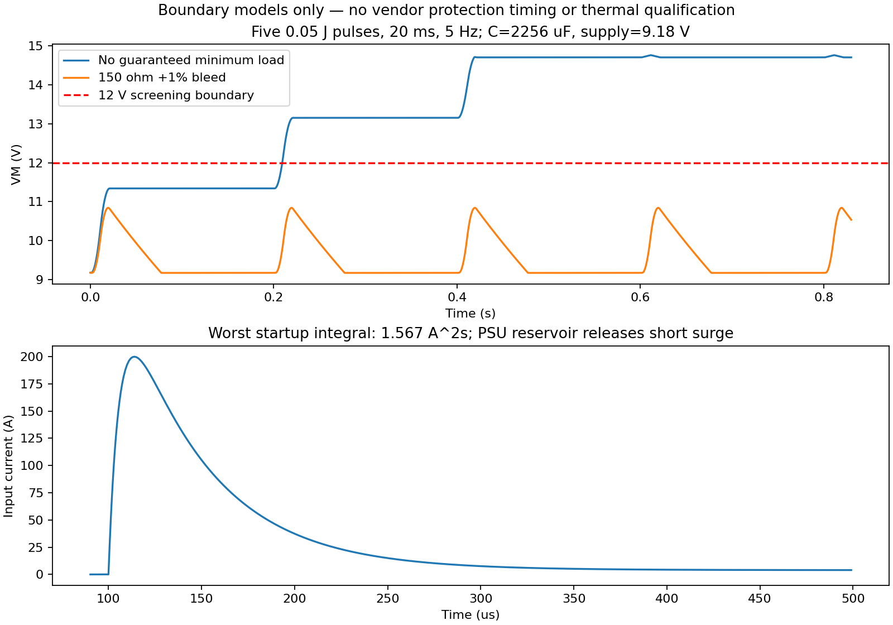

# A1 保护修订：确切料号、输入RLC与有限制动能量

本轮修订基于提交d21cfc5；当前文件哈希见run-status.json及release-status.json。F1、四路PTC及若干MLCC料号已纠正；PTC扩焊盘后GP8/GP9作了局部避让，未改变引脚或机械外形。**制造/硬件测试状态仍为false。没有使用TI器件模型，也未重试被禁TI下载。**

## 已实施的最小修改

1. F1原写`0467008.NR / 1206 / 8A`，原厂467系列实际是0603且最高5A，不能制造。改为原厂明确的`0407008.WR`，1206、8A/24VDC时滞，60A分断；本地407焊盘为1.0×1.8mm、中心±1.25mm，按第4页文字尺寸1.0/1.8/1.5/3.5重建，并保留端子覆盖检查。在线截图未提供可见像素，未虚称独立目视箭头核验。两原连接点仍在新焊盘内，未改原走线。
2. R500/R501：两只`CRCW2512300RFKEG`、300Ω±1%、2512、1W，并联成150Ω最低母线负载。解决没有可保证最小负载时重复小制动脉冲在2820µF上积累的问题；9.18V时耗散合计0.562W，各0.281W。位置在上部空闲区，中心间距15mm，避开控制器与大电解。不是大功率制动器。
3. 首板工作预算改为入口连续≤5A、单臂初始热验证目标≤0.75A RMS；43.2k驱动限流未改，保留短时扭矩。预算必须实测，现有固件并未增加电流/能量监测或强制限额。
4. 本次独立BOM审查的其他确切料号修正见`electronics/sources/bom-exact-part-audit.md`；以最终BOM为准，不把旧生成表或ERC当原厂依据。

## 输入：48个已运行RLC边界工况

用ngspice44.2模拟接通1µs斜坡、原厂F1冷阻包含于线阻、入口理想单向器件20mV+3.3mΩ近似、实际2820µF±20%、母线等效ESR10mΩ。新增300Ω×2已纳入。4ms后接入4A负载，仿真到10ms。

|参数|扫描或设定|依据/限制|
|---|---|---|
|电源空载电压|8.82/9.18V|规定9V±2%|
|电源动态等效电阻|30mΩ|敏感性假设，须测|
|电源限流|6.5A，瞬时理想限流|选源要求/模型，不代表已知电源响应|
|电源输出电容|470/2200µF|明确的适用范围假设；输出电容可在限流环外释放脉冲|
|线缆+接头+F1电阻|20/60/120mΩ|候选0.25～1m单程、0.75～1.5mm²铜线，含接头/温升/保险|
|线缆回路电感|0.2/2µH|成对布线的边界假设，包含连接器；不采用无电感理想线|
|接通路径电阻|5mΩ|接点假设|

铜线直流依据ρ约0.0175Ω·mm²/m，用`R=2ρl/A`得20°C约5.8～46.7mΩ；温升、接头和保险额外计入。平行双线回路可用`L≈(μ0/π)l·acosh(d/2r)`估量，所用0.2～2µH覆盖紧靠线对至较分离布线的敏感性范围，**实际线缆还没测量**。要求成对供电回线、单程≤1m、≥0.75mm²，并实测总等效串阻≤约160mΩ；8.82V、5A下压降须留出降压输入≥8V。绝不把低源阻大电池当合格输入。

结果：入口峰值47.43～199.97A，但启动0～4ms I²t为0.2088～1.5673A²s，仅为新F1**名义**熔断I²t24.12A²s的0.87～6.50%。VM峰值8.158～9.156V，结束电压8.158～8.923V。输出电容导致窄脉冲峰值仍高，然而积分远低于之前未获原厂支持料号无法核对的状态；因此**没有机械增加NTC或热插拔IC**。

该比值不是保险寿命保证：24.12是名义熔化I²t、不是最小保证或总开断值；通用重复降额要求约10秒冷却。首次选电源测热插拔电流、I²t、接点弹跳及MOS体二极管/栅极建立；本模型不含LM74700时序与MOS SOA。源长期短路必须限流，不能靠时滞F1快速保护芯片。F1额定分断60A不等于允许任意短路电源；开断时的预期电流与外部电源/储能仍需协调。禁止大电池/未知大输出电容源。整机连续≤5A，也低于F1原厂75°C例子的5.44A允许值，仍需测保险附近温度。

## 重复制动：60个已运行能量工况

每次向VM注入**总能量**0.02/0.05/0.1/0.3/1J的三角功率脉冲，宽5/20/100ms、频率1/5Hz，各5次；对比无最低负载和150Ω+1%泄放。使用最小电容2256µF、初值9.18V，忽略电机/驱动耗散（将设定能量全送回母线），其他负载为零。输入仅补足9.18V以下电压，不吸收回灌。

|每次回灌总能量|有泄放时扫描最高VM|判断|
|---|---:|---|
|0.02J|低于0.05J工况|暂定范围内|
|0.05J|11.204V|所有脉宽/频率工况TVS电流为0；低于12V设计边界|
|0.1J|13.007V|越过12V边界，不接受；不能因TVS尚未导通而说安全|
|0.3J|15.604V|需要TVS耗能，不在当前工作边界|
|1J|18.105V|TVS最后事件折算平均功率最高约4.206W，不接受|

因此选择**整板回到母线的能量≤0.05J/次、≤5Hz、5～100ms**的首板验证边界。两个泄放电阻的作用是让正常定义工况不依赖TVS周期性雪崩，TVS保留给异常脉冲。实际能量未测，不能宣称机器已经符合该边界；更高机械能或频率需重算，可能要专用制动耗能电路，而不是只换更大的TVS。

独立上界：2256µF从9.18V瞬间吸收0.05J后的电压为`sqrt(9.18²+2E/C)`≈11.34V；在151.5Ω上从该电压放至9.18V约72ms，小于最短200ms事件周期减最长100ms脉宽。实际仿真包含脉冲期间放电，所以峰值稍低。断电时150Ω和2820µF的名义时间常数0.423s，约0.93s从9V衰减到1V；这也须测，不承诺触电/残压安全等级。

Littelfuse SMBJ12A的600W为规定非重复10/1000µs脉冲，5W连续值要求引线50°C无限散热器，不能套用于本板。60工况用静态分段线性TVS，仅能做能量/电压筛查，不给出结温、重复寿命、寄生尖峰及失效时间。

## 机械能与占空比：明确未知量

`mechanical_envelope.csv`提供36行，不把它当实物参数：每臂输出侧等效惯量J取3e−5/1e−4/3e−4/1e−3kg·m²，转速60/120/175rpm，绕组电感0.5/2/10mH；电流上界1.613A。`Emax=4·0.5Jω²+4·0.5LI²`，还须加外力做功/下降重力势能。J必须包括马达转子惯量×减速比²和外部负载，不能只算魔方。175rpm来自EV3原厂9V空载值；J和L是扫描假设。

示例J=1e−4kg·m²/臂、120rpm、L=2mH，四臂总能量上界约0.042J，落在所选0.05J内；同J以175rpm则约0.0776J，超出。这只示范怎样判断，不证明真实马达或机器人满足。首板需测VM电压和电流积分，连同速度/机械配置确定实际边界；不允许持续外力反拖。

热目标：I_RMS≤0.75A、环境≤40°C，敏感性按热态桥阻1.13Ω、开关损耗暂留0.1W、有效θJA100°C/W，估Tj113.6°C。这三个参数未获得本板保证，需四臂并发热测，目标Tj<125°C；没有把TI参考板热阻当本板实测。若背景电流≤0.2A，1.613A脉冲100ms/500ms一次的RMS约0.743A，说明20%占空的量级；不得把20%PWM占空直接当20%电流占空，刹车时绕组电流仍可能流动。未改驱动限流门限，避免无依据削弱夹持/转动扭矩。

## 检查、重建与未决

重跑：`python electronics/simulation/run_protection.py --ngspice ngspice`。108个网表、日志及压缩波形在本目录；最大能量积分残差约1.52mJ（见CSV，各工况不同）。这是数值能量平衡检查，不是器件拟合精度。原始65工况为历史基线，不能当新板仿真。

原生原理图/PCB/BOM已更新；ERC/DRC及逐引脚契约检查以最终生成报告为准。须完成原厂TPS54302模型、EV3确切料号/针序/载流、安装托架/线缆净空和样机并发/回灌/热/USB组合供电测试。不得下单。

本轮未重试TI被禁下载。需要环境管理员/用户正规更新允许域名：`www.ti.com`（TI模型）、`www.littelfuse.com`、`www.bourns.com`（原厂PDF本地视觉复核；代理CONNECT正文均为Domain forbidden，在线文本可读）。不使用外部转存规避权限。其他原厂资料当前可经已授权网页工具读到，未要求扩大权限。
