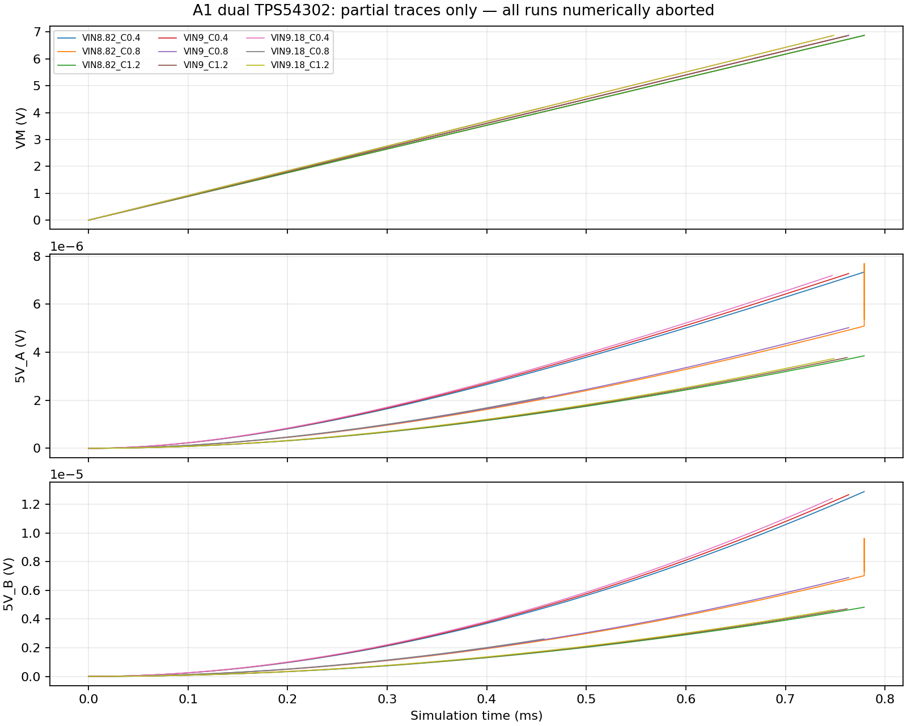

# A1 双TPS54302原厂模型验证：数值阻塞，未通过

日期：2026-10-12。九个双路工况均真实运行，但均在启动期间数值中止；**0个完成，0个通过**。负载阶跃尚未执行到，不能宣称降压、环路或整板合格，也不能从数值失败推断实物电路失败。

## 工程与工具

- A1基线Git：`e34395e68b175cf9a279664fd4a13fd6573d95db`；PCB SHA256：`9e55fcbee01241fc6ec3682fde79daaacd6bc623ecfc311809600e001099350a`。
- 电路定义SHA256：`e90767906205461e028785313fd5f1c17ea48440ee5bd65a107c31c6d903ade2`。
- KiCad 10.0.7 Lite；ngspice 44.2（Debian官方包，启用ps兼容及XSPICE analog/xtradev）。
- 原厂模型：TI [slvmbl9](https://www.ti.com/lit/zip/slvmbl9)，同域重定向slvmbl9a.zip；原LIB SHA256：`52a568f08f1eed44961238a1ff10b68c2ce1faa1cdf2c24659b17b1f820f0026`。
- 适配LIB SHA256：`34d6bd4e29009f06b95d75fb82b91d3c0d4d783ea3ba92be318467bfa51790f8`；补丁见[compatibility.patch](compatibility.patch)。

## 唯一保留的模型转换

- 原厂脚序为 `BOOT EN GND PH VIN VSENSE PARAMS: STEADY_STATE=0`，显式映射PH→SW、VSENSE→FB；未改变脚序。
- `MONONEG_PS`的一处PSpice逻辑异或`^`在ngspice展开后成为幂运算。四组合00/01/10/11中，比较项先加括号再做幂运算得到1/0/1/1；直接展开未加括号的原表达式得到0/0/0/1（见diagnostics/xor-unparenthesized日志）。改成带括号的布尔不等式后为0/1/1/0。见compatibility中的网表与日志。该子电路被两处调用。
- 文本序列化CRLF→LF；其余模型参数、开关、保护及控制逻辑保留。没有采用二极管放宽或钳位平滑实验。
- 原模型内部`.IC V(EN )=0`出现`x1.en/x2.en`不存在的警告；本工况0 V输入、EN分压网络初始解已为0 V。警告完整保留，未冒称完全无兼容警告。

## 实际BOM、工况与阈值

U2/U3均TPS54302DDCR；每路10µH、DCR21.4mΩ（典型），输入10µF+100nF，输出2×22µF/25V，100k/13.3k反馈、75pF前馈，BOOT49.9Ω/100nF、EN511k/105k；470µF可选输出电容默认DNP。两路负载分别0.25A/0.05A，12ms升至1.5A，18ms恢复。输出接近0V时负载平滑降为0，避免不物理的恒流负载抽负压。
VM以1ms从0升至8.82/9/9.18V；输入及输出主陶瓷电容容量系数0.4/0.8/1.2。0.4仅是未知DC偏压影响的严苛敏感性，不是原厂保证。输出ESR3mΩ是假设，未覆盖L容差/全部ESR/反馈电阻/源阻抗联合扫描。
VM由理想PWL电压源直接驱动，输入10µF/100nF与其并联；因此改变输入电容不能验证VM纹波、输入源阻抗或输入电容动态容差。该矩阵仅尝试输入电压和输出有效电容敏感性，后续必须加入有依据的电源/线束阻抗及输入电流测量。
目标结束25ms；10ms前达到4.75V，10ms以后4.75～5.25V，启动全程不超过5.25V，电感绝对峰值<6A。原厂模型未涵盖温度影响；这里不作热/相位裕量/故障时序认证。

## 九个真实运行结果

| 工况 | 最后时刻(ms) | 数据点 | 完成/通过 |
|---|---:|---:|---|
| VIN8.82_C0.4 | 0.779071 | 10204 | 否/否 |
| VIN8.82_C0.8 | 0.779275 | 12097 | 否/否 |
| VIN8.82_C1.2 | 0.779074 | 10553 | 否/否 |
| VIN9_C0.4 | 0.763480 | 9688 | 否/否 |
| VIN9_C0.8 | 0.763498 | 10432 | 否/否 |
| VIN9_C1.2 | 0.761901 | 9166 | 否/否 |
| VIN9.18_C0.4 | 0.747011 | 9296 | 否/否 |
| VIN9.18_C0.8 | 0.457551 | 5375 | 否/否 |
| VIN9.18_C1.2 | 0.748608 | 10335 | 否/否 |

全部为`Timestep too small`。ngspice进程返回0仍被判为失败；判据同时检查错误日志、有限数据、递增时间与25ms结束点。每个目录含网表、完整日志和压缩的**部分**波形；summary.csv包含具体报错节点。



## 独立基线与未采用实验

详见[兼容实验记录](compatibility/README.md)。TI包带OrCAD二进制DSN和仿真profile，没有可直接运行的导出.cir/.net；未冒称运行了原厂示例。自选12V→约5V的最小启动基线原模型在0.654881ms中止；Gear积分陷于0.209081ms附近并被终止。实际A1标称网表的原模型Trap/Gear均在约0.762～0.763ms中止；单独将D_D的n由1e-5放宽至1e-3，以及在XOR修正上平滑SDWN钳位，均未解决，已弃用。

后续数值设置、内部节点和求解器版本对照见[追加诊断](diagnostics/README.md)。

## 结论与后续

**工具和模型获取已解阻；原厂模型的ngspice动态兼容仍未解阻。** 尚不能完成有效启动、负载阶跃和容差验收。下一步需要在TI支持的PSpice环境对同一实际BOM建立对照，或针对完整宏模型进行有依据且可对照的ngspice移植；不得继续任意放宽器件/保护逻辑直到“通过”。
现有65个简化边界工况和108个保护/RLC/能量工况仍是独立的历史分析，不能代替本原厂芯片动态验证。没有因数值失败改动板上BOM或电路。EV3针序/视向/型号/载流、实物热、USB、机械等HOLD继续保持，制造仍NOT RELEASED。

## 重现

```sh
python electronics/simulation/run_buck_vendor.py --model /absolute/path/TPS54302_TRANS.LIB --ngspice /path/to/ngspice
python electronics/simulation/report_buck_vendor.py
python -m unittest discover -s electronics/simulation -p test_buck_vendor.py
```

首次命令必须提供SHA匹配的未修改原厂LIB；脚本在被忽略的output/electronics/ti-model下生成适配副本。需先使ngspice能加载analog.cm、xtradev.cm等官方代码模型；本环境可用/workspace/tools/bin/ngspice-44。模型本体未随Git再分发，保留TI版权及免责声明；不推断额外分发许可。
